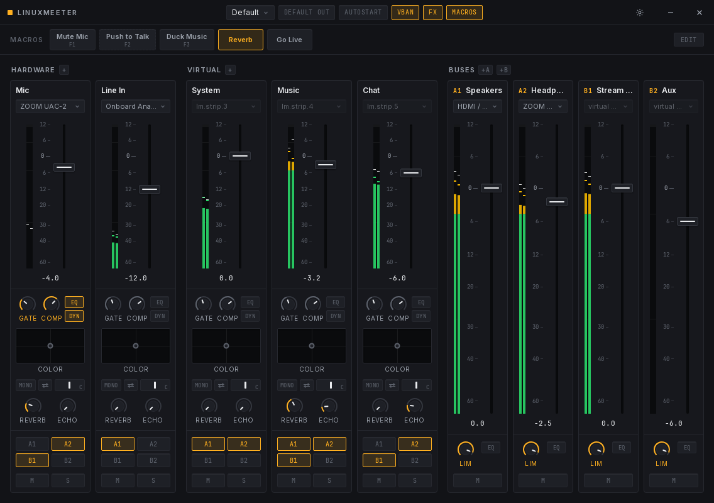
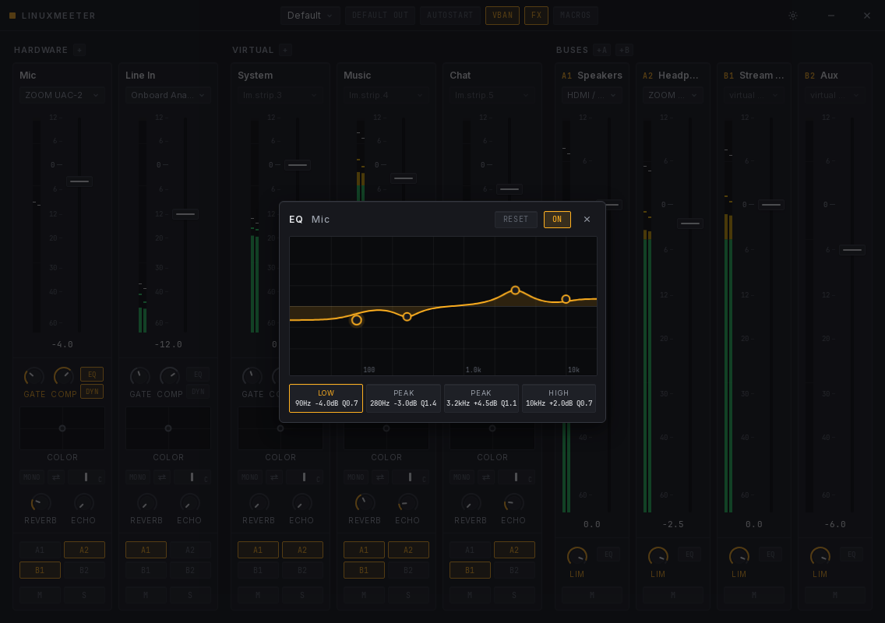
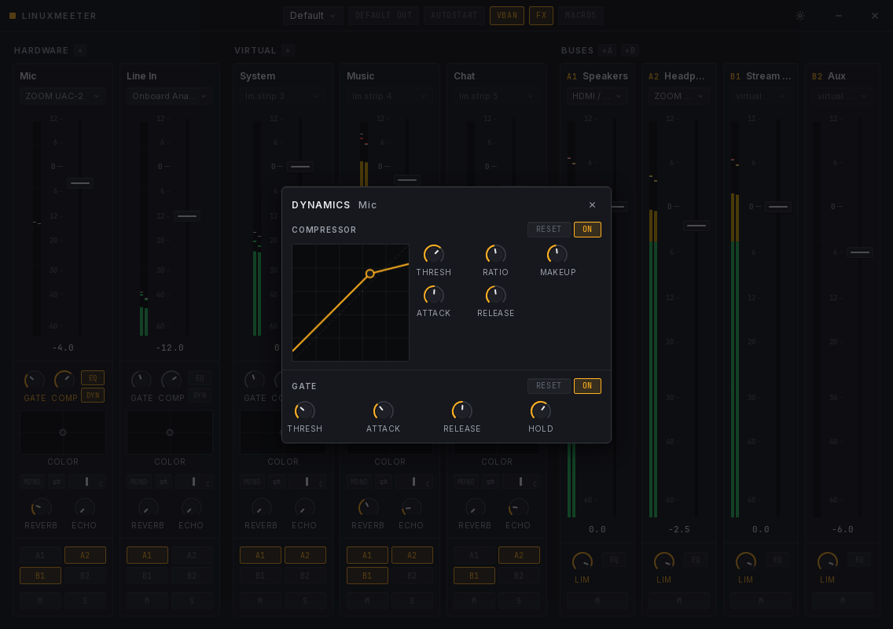
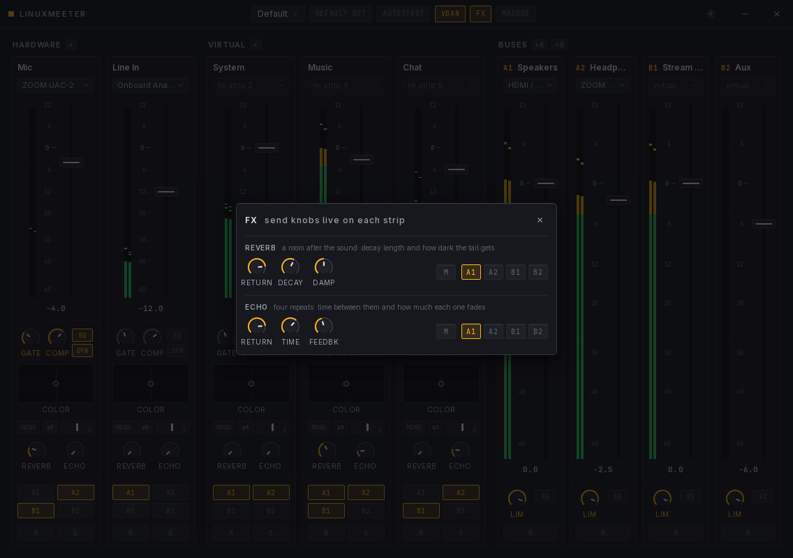
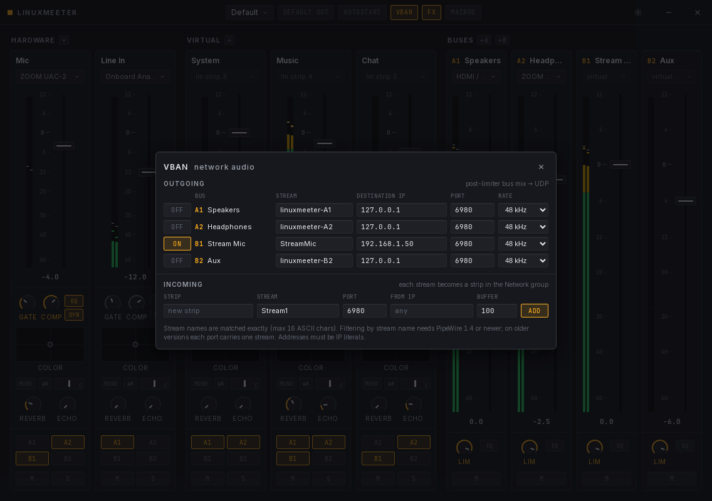

# linuxmeeter

A VoiceMeeter-style virtual audio mixer for Linux, built natively on
**PipeWire**. Route any app or microphone through gated, compressed, EQ'd
channel strips into hardware outputs and virtual microphones that Discord,
OBS, or any recorder can use.



## Features

- **Input strips** — hardware strips capture real devices (mic, line in);
  virtual strips appear as output devices apps can play into
  (System / Music / Chat out of the box)
- **Per-strip DSP** — gate, compressor (with transfer-curve editor),
  4-band parametric EQ with an interactive response curve, and a
  VoiceMeeter-style **voice color** XY pad — all powered by the
  [LSP](https://lsp-plug.in) LV2 plugins inside PipeWire filter-chains

  

  

- **Stereo image per strip** — VoiceMeeter-style **MONO** and **⇄**
  (swap left/right) buttons plus a balance slider, applied after the EQ
- **Reverb and echo** — **REVERB** / **ECHO** send knobs on every strip
  feed two shared effects; the **FX** panel sets each return's level, mute,
  which buses it feeds, reverb decay and damping, and echo time and feedback.
  Both run on PipeWire's built-in filters (the reverb's impulse response is
  generated on the fly), so no extra plugins are needed

  

- **Macro buttons** — a bar of pads (**MACROS** in the top bar) that each
  run a list of actions: mute, solo, route, set a fader, mute an effect
  return, start/stop a VBAN output, or toggle Default out. **Toggle** pads
  switch between an on and an off list; **Push** pads run one while held
  and the other on release (push-to-talk). Each pad can have a keyboard
  shortcut that works while the window has focus
- **Output buses** — up to five A buses (A1–A5) to hardware devices and
  three B buses (B1–B3) as **virtual microphones** (post-limiter) selectable
  in any app; add them with **+A** / **+B**. Every bus has an 8-band
  parametric **EQ** ahead of its limiter
- **Your own layout** — add hardware or virtual strips with **+**, remove
  any strip or bus (hover its name, click ✕ twice), double-click a name to
  rename it
- **Routing matrix** — one toggle per bus on every strip, applied as live
  PipeWire links; mute/solo; peak/RMS metering with clip latch at 30 fps
- **VBAN network audio** — send any bus's post-limiter mix to
  VoiceMeeter (or any VBAN receiver) on another machine, and receive
  VBAN streams as their own input strips with full DSP and routing. Built
  on PipeWire's native `vban-send` / `vban-recv` modules; configure it from
  the **VBAN** button in the top bar

  

- **Default-output takeover** — one click makes the System strip your
  default sink so *all* desktop audio flows through the mixer
- **Profiles** — everything persists to `~/.config/linuxmeeter/` (TOML,
  hand-editable) and restores on launch; tray icon + close-to-tray +
  optional autostart keep your devices alive from login
- **Clean by design** — all virtual devices live in-process and vanish
  completely when the app exits; WirePlumber is never left managing our
  volumes

## Requirements

- PipeWire ≥ 1.4 with WirePlumber (the pulse compatibility layer is used by
  most apps, but linuxmeeter itself talks native PipeWire). The filter-chain
  module must be built with LV2 support: Ubuntu 24.04's PipeWire 1.0.5 is
  not, so no strip or bus can load there
- `lsp-plugins-lv2` (gate/compressor/EQ/limiter DSP)
- `webkit2gtk-4.1`, `gtk3`, `libayatana-appindicator` (UI shell + tray)

## Building

```sh
pnpm install
pnpm tauri dev          # development (mixer runs against your live graph)
pnpm tauri build --no-bundle   # release binary at target/release/linuxmeeter
```

`pnpm tauri build` (with bundling) also produces a `.deb` under
`target/release/bundle/deb/`. Arch users: see `packaging/PKGBUILD`.

## Development notes

- `pnpm dev` in a plain browser runs the full UI against a **mock backend**
  with simulated meters — the design-iteration environment.
- The workspace splits into `lm-protocol` (shared types), `lm-engine`
  (all PipeWire code, testable headless — see `examples/`), and `src-tauri`
  (shell + IPC).
- `cargo run --example graph -p lm-engine` drives the full audio topology
  from a REPL without the UI.

## License

GPL-3.0-or-later. Bundled fonts (Inter, JetBrains Mono) are under the SIL
Open Font License.
